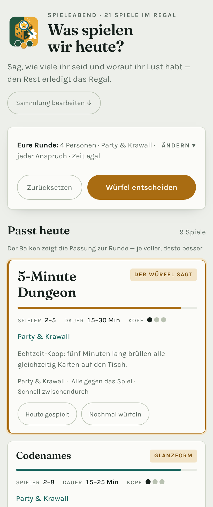

# Was spielen wir heute?

**Welches Brettspiel passt zur heutigen Runde?** Du sagst, wie viele ihr seid,
worauf ihr Lust habt, wie viel Kopf ihr habt und wie viel Zeit — die Seite
sortiert deine Sammlung danach durch und schlägt vor, was heute auf den Tisch
kommt. Was nicht passt, verschwindet nicht kommentarlos, sondern steht unten mit
Begründung.



Eine **Android-App**, und darunter eine einzelne HTML-Datei: ohne Baukasten,
ohne Abhängigkeiten, ohne Konto und **ohne eine einzige Anfrage ans Internet** —
selbst die Schriften stecken mit drin. Dieselbe Datei lässt sich auch einfach im
Browser öffnen, per Doppelklick.

Die Ausgangssammlung sind 21 Spiele aus meinem Regal. Sie ist nur der
Startpunkt: Spiele lassen sich auf der Seite selbst hinzufügen, ändern und
entfernen.

**Aufs Handy:** [neueste Android-App herunterladen](../../releases/latest).

**Nur kurz ansehen:** [`index.html`](index.html) herunterladen und im Browser
öffnen — dieselbe Anwendung, ohne Installation.

---

## Als App auf dem Handy (Android)

1. Am Handy die [neueste Veröffentlichung](../../releases/latest) öffnen und
   die Datei `spieleabend-1.2.3.apk` herunterladen (die Nummer ist die Fassung).
2. Die heruntergeladene Datei antippen. Android fragt beim ersten Mal, ob Apps
   aus dieser Quelle installiert werden dürfen — einmalig bestätigen.
3. Fertig. Die App liegt im App-Menü, mit eigenem Symbol.

Eine neuere Fassung installiert sich über die alte, die Sammlung bleibt dabei
erhalten. **Ausnahme:** Wer noch eine Fassung bis 1.2.0 installiert hat, muss
einmalig deinstallieren — vorher die Sammlung sichern, Deinstallieren löscht sie
mit. Der Grund steht in der [Änderungshistorie](CHANGELOG.md) unter 1.2.1.

Jede Fassung bekommt eine eigene Veröffentlichung, die danach unverändert
bleibt. Was sich geändert hat, steht dort und in der
[Änderungshistorie](CHANGELOG.md). Welche Fassung bei dir läuft, steht ganz
unten auf der Seite.

Die App enthält alles und braucht **kein Netz**. Deine Sammlung liegt im
Speicher der App, auf diesem Handy.

**Sicherung — wichtig vor einem Handy-Wechsel.** Unter „Sammlung bearbeiten" →
„Sicherung & Umzug":

- **Text kopieren** — klappt immer. In eine Notiz oder E-Mail einfügen.
- **Als Datei sichern** — legt eine `.json`-Datei ab, wo dein Handy Downloads
  speichert. Falls nichts passiert: den Textweg nehmen.
- **Datei einlesen** — auf dem neuen Gerät die Sicherung auswählen, dann
  „Sammlung ersetzen".

**Neue Fassung bauen:** Im Reiter *Actions* → *APK bauen* → *Run workflow*.
Nach ein paar Minuten hängt die neue Datei an derselben Veröffentlichung. Das
passiert auch automatisch, sobald sich `index.html` ändert.

Die App ist mit einem festen eigenen Schlüssel signiert; der Fingerabdruck steht
bei jeder Veröffentlichung. Weil sie nicht aus dem Play Store kommt, zeigt
Android beim Installieren trotzdem einen Hinweis.

---

## Was die Seite macht

- **Harte Filter**: Spielerzahl, Zeitbudget, Anspruch, Stimmung. Was rausfällt,
  steht unten mit Begründung („nur bis 4", „dauert ab 60 Min").
- **Erklärzeit**: Spiele, die noch niemand kann, lassen sich im Formular als
  „Muss noch erklärt werden" markieren. Das Zeitbudget rechnet den Aufschlag
  dann mit — abgeleitet aus dem Anspruch: leicht +5, mittel +10,
  anspruchsvoll +20 Minuten. Ein 45-Minuten-Kennerspiel braucht damit
  65 Minuten und fällt aus einer Stunde heraus, mit Begründung
  („mit Erklärung ab 65 Min"). Ist das Spiel eingeführt, Haken raus.
- **Rangfolge**: Treffer werden nach Passung sortiert. Der beste Vorschlag steht
  oben groß, die Balken zeigen, wie gut ein Spiel zur Runde passt.
- **Glanzform**: Ein Spiel, das bei genau dieser Spielerzahl am besten läuft,
  bekommt ein eigenes Kennzeichen.
- **Würfel entscheiden**: Wenn die Diskussion zu lange dauert, zieht der Knopf
  zufällig aus der oberen Hälfte der Treffer.
- **Zuletzt gespielt**: Auf jeder Karte sitzt unten „Heute gespielt". Einmal
  antippen, und die Seite merkt sich das Datum — nochmal antippen nimmt es
  zurück. Ältere Termine trägst du unter „Sammlung bearbeiten" → „Ändern" von
  Hand nach. Lange Ungespieltes steigt danach in der Rangfolge, gerade Gespieltes
  fällt (unter zwei Tagen deutlich), verschwindet aber nie ganz: eine Revanche
  soll auffindbar bleiben. Der Chip **„Lange nicht gespielt"** in der Filterreihe
  „Regal" zeigt nur, was seit über 90 Tagen nicht dran war.
- Die letzte Einstellung wird im Browser gemerkt.

## Sammlung pflegen

Unten auf der Seite: **Sammlung bearbeiten**.

- **Hinzufügen** — Name, Spielerzahl, Dauer, Anspruch und mindestens eine
  Stimmung; „Am besten zu" ist optional und meint die Spielerzahl, bei der das
  Spiel wirklich glänzt (davon hängt das Glanzform-Kennzeichen ab).
- **Daten vorschlagen** — nur den Titel eintippen, den Rest füllt Claude aus
  (siehe unten).
- **Ändern** — füllt dasselbe Formular mit dem vorhandenen Spiel. Dort steht auch
  **„Zuletzt gespielt"** als Datumsfeld: nachtragen, korrigieren oder leeren
  (leer heißt „noch nie"). Datumsangaben in der Zukunft weist das Formular ab.
  Daneben der Haken **„Muss noch erklärt werden"**; markierte Spiele tragen in
  der Liste den Vermerk „erklären".
- **Entfernen** — sofort, mit „Rückgängig" direkt daneben.
- **Zurücksetzen** — holt die 21 Ausgangsspiele zurück (Sicherheitsklick).
- **Suchen und Sortieren** — Suchfeld über der Liste, dazu Sortierung nach Name,
  Spielerzahl, Dauer, Anspruch oder „Lange nicht gespielt".
- **Sicherung & Umzug** — die ganze Sammlung als Text zum Aufheben, Ergänzen
  („Dazu einspielen") oder Ersetzen; auch der Weg für BGG-Daten (siehe unten).

### Nur den Titel eintippen

Neben dem Namensfeld steht in der veröffentlichten Seite ein Knopf
**„Daten vorschlagen"**. Er fragt Claude nach Spielerzahl, bester Besetzung,
Dauer, Anspruch, Stimmung und einem Notizsatz und trägt alles ins Formular
ein — gespeichert wird nichts, bis du auf „Ins Regal stellen" tippst. Der
Vorschlag steht also immer zur Korrektur, und genau so ist er gemeint:

- Claude kennt viele Spiele, aber nicht alle, und Auflagen unterscheiden sich.
  Kennt es das Spiel nicht sicher, sagt es das, statt Zahlen zu erfinden.
  Trotzdem: **die Werte vor dem Speichern kurz ansehen.**
- Der Titel wird auf die offizielle Schreibweise gesetzt, wenn sie abweicht —
  die Zeile unter dem Feld sagt es dann.
- Die Abfrage läuft über deine Claude-Nutzung; beim ersten Mal fragt die Seite
  um Erlaubnis. Ein zweiter Klick auf den Knopf bricht eine laufende Abfrage ab.

Der Knopf erscheint nur in der veröffentlichten Seite. Die lokal geöffnete
`index.html` hat keinen Zugang zu Claude und blendet ihn aus.

### Ein einzelnes Spiel von BGG übernehmen (ohne Terminal)

Für ein einzelnes Spiel braucht es kein Skript:

1. Unter „Sammlung bearbeiten" den Titel ins Namensfeld tippen.
2. **„Auf BGG nachschlagen ↗"** öffnet die BGG-Suche zu diesem Titel in einem
   neuen Tab. Dort das Spiel anklicken.
3. Auf der BGG-Seite stehen oben rechts alle nötigen Zahlen: *Players*,
   *Playing Time*, *Weight* — und im Kasten *Community* unter „Best" die
   Spielerzahl, bei der es am besten läuft.
4. Zahlen ins Formular übertragen. Das *Weight* (1–5) wird zum Anspruch:
   bis 1,5 leicht, 1,5–2,6 mittel, ab 2,6 anspruchsvoll — die Umrechnung steht
   auch unter den Anspruch-Knöpfen.
5. Stimmung wählen, Notiz schreiben, „Ins Regal stellen".

Die Seite kann BGG nicht selbst abfragen: veröffentlichte Artifact-Seiten dürfen
keine fremden Server ansprechen, und die BGG-XML-API erlaubt Browser-Zugriffe von
fremden Seiten ohnehin nicht. Darum der Weg über den Link und das Formular.

### Wo die Sammlung liegt

Die Zeile über dem Formular sagt es:

- **In der App und im Browser** auf dem jeweiligen Gerät. Umzug auf ein anderes
  Gerät: über „Sicherung & Umzug".
- **Als veröffentlichte Claude-Seite** zusätzlich im Konto — dann sehen Handy
  und Laptop dieselbe Sammlung.

Auf das Gerät wird in beiden Fällen geschrieben, damit auch offline etwas da
ist.

Ist beim ersten Öffnen noch nichts gespeichert, gilt die Ausgangssammlung aus
`DEFAULT_GAMES` in `index.html`. Diese Liste ist nur der Startpunkt — wer lieber
im Code arbeitet, kann sie dort weiterhin bearbeiten:

```js
{ name:"Scout", min:2, max:5, best:[3,5], dur:[15,25], weight:1.6,
  moods:["schnell","gruebeln"],
  note:"Kartenhand, die du nicht sortieren darfst. …" },
```

- `min`/`max` — Spielerzahl laut Schachtel
- `best` — die Spanne, in der es wirklich glänzt
- `dur` — Dauer von/bis in Minuten
- `weight` — 1 (Absacker) bis 5 (Kennerstück); daraus ergeben sich die drei Pips
- `moods` — Schlüssel aus dem Objekt `MOODS` darüber

Achtung: Sobald über die Seite etwas geändert wurde, gilt die gespeicherte
Sammlung. Änderungen an `DEFAULT_GAMES` schlagen dann erst nach
„Auf Ausgangssammlung zurücksetzen" durch.

## Fassungen

Die Nummerierung folgt [Semantic Versioning](https://semver.org/lang/de/): bei
**X**.y.z ändert sich etwas Grundlegendes, bei x.**Y**.z kommt etwas dazu, bei
x.y.**Z** wird etwas repariert. Was in welcher Fassung passiert ist, steht in
der [Änderungshistorie](CHANGELOG.md); jede Fassung hat außerdem eine eigene
[Veröffentlichung](../../releases) mit der passenden APK.

## Schriften

Die beiden mitgelieferten Schriften stehen unter der SIL Open Font License 1.1;
Nachweis in [`SCHRIFTEN.md`](SCHRIFTEN.md).

## Nutzungsrechte

Für dieses Projekt ist bewusst noch keine Lizenz vergeben. Damit gilt das
normale Urheberrecht: Der Quelltext ist einsehbar, eine Weiterverwendung ist
ohne Absprache aber nicht gestattet. Wenn du es verwenden möchtest, frag einfach.
