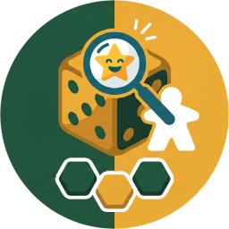
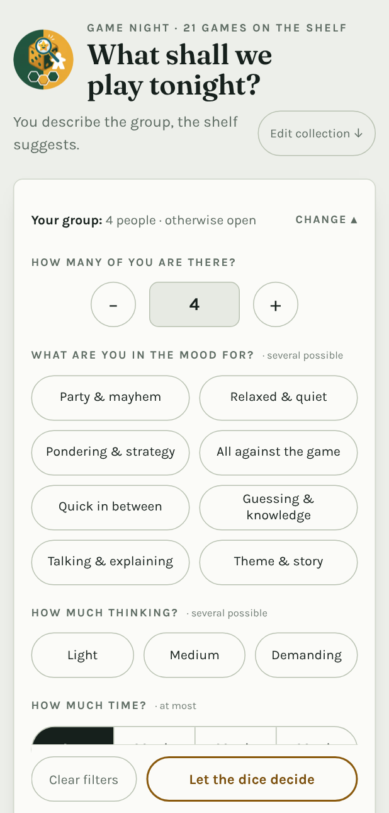
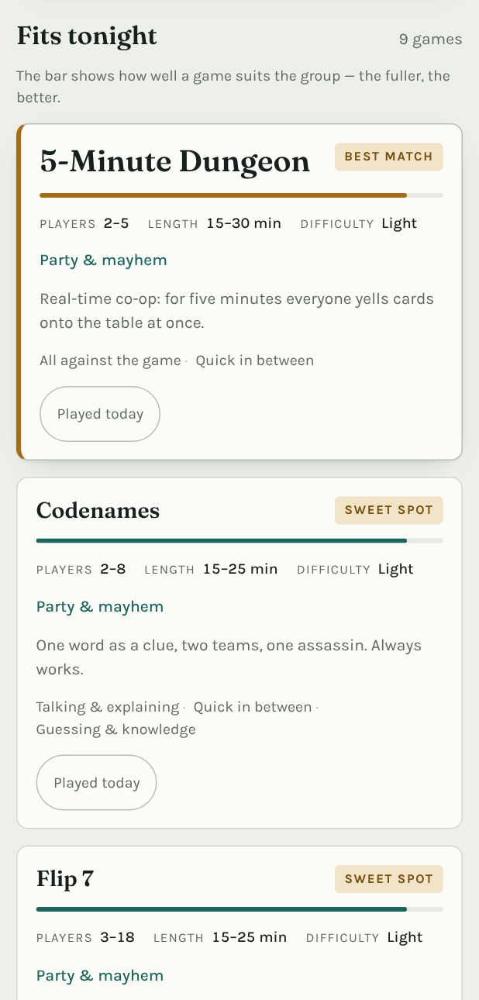
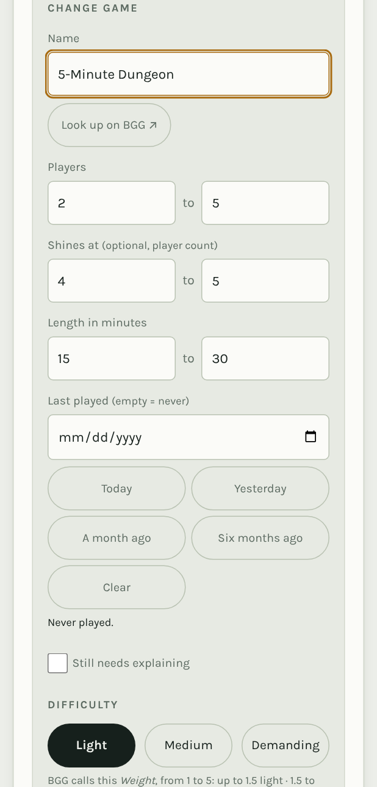
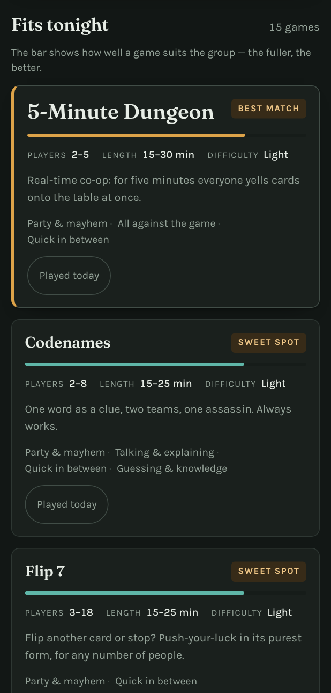

<p align="center">
  
</p>

# What shall we play tonight?

**Which board game fits tonight's group?** You say how many of you there are,
what you are in the mood for, how much thinking you are up for and how much
time you have — the page sorts your collection by that and suggests what to put
on the table. Whatever does not fit is not dropped silently: it is listed below
with the reason.

<p align="center">
  
  
  
  
</p>

An **Android app**, and underneath it a single HTML file: no build system, no
dependencies, no account and **no request to the internet unless you ask for
one** — even the fonts are baked in. The same page runs as a web app (for
iPhone and iPad, or any browser) and opens from a local file by
double-clicking it.

The shelf starts **empty**: you add your own games. To try the app first, the
empty shelf offers **Load example games** — nine well-known titles you can
remove one by one later.

**On your phone:** [download the latest Android app](../../releases/latest).

**In the browser / on iPhone:** <https://dr-nerdlove.github.io/board-game-recommender/>
— the same application, no installation. How to keep it on an iPhone is
described [below](#on-iphone-and-ipad-web-app).

---

## As an app on your phone (Android)

1. On the phone, open the [latest release](../../releases/latest) and download
   the file `spieleabend-1.2.3.apk` (the number is the version).
2. Tap the downloaded file. The first time, Android asks whether apps from this
   source may be installed — confirm once.
3. Done. The app sits in the app drawer with its own icon.

A newer version installs over the old one and the collection survives.
**Exception:** anyone still on a version up to 1.2.0 has to uninstall once —
back up the collection first, uninstalling deletes it. The reason is in the
[changelog](CHANGELOG.md) under 1.2.1.

Every version gets its own release, which stays unchanged afterwards. What
changed is written there and in the [changelog](CHANGELOG.md). Which version you
are running is at the very bottom of the page.

The app contains everything and needs **no network** (only **Find data**
does). Your collection lives in the app's storage, on this phone.

**Backup — important before switching phones.** Under **Edit collection** →
**Backup & moving**:

- **Copy as text** — always works. Paste it into a note or an e-mail.
- **Save as file** — in the app, Android's share sheet opens and you choose
  where the `.json` file goes. "Save to files" puts it in the Downloads folder,
  for example; mail, Drive or a chat work just as well. In a browser it lands in
  the Downloads folder directly.
- **Read a file** — on the new device, pick the backup, then **Replace
  collection**.

**Building a new version:**

- **Android app:** the *Actions* tab → *Android-App bauen* → *Run workflow*,
  with the "veroeffentlichen" (publish) box ticked. A few minutes later the new
  release is there with its APK. Without the tick it is only a trial build.
  Pushing a tag `v1.2.3` does the same thing. The APK never builds on its own.
- **Web version:** updates itself — every push to `main` that touches the web
  files publishes it again (*Web-Version veroeffentlichen*).

The app is signed with a fixed key of its own; the fingerprint is given with
every release. Because it does not come from the Play Store, Android still shows
a warning when installing.

---

## On iPhone and iPad (web app)

Free, and without the App Store (which would need a paid Apple developer
account): the page is also published as a web app.

1. Open <https://dr-nerdlove.github.io/board-game-recommender/> in **Safari**.
2. Tap **Share**, then **Add to Home Screen**.

After the first visit it runs offline.

**Important — two things on iPhone:**

- **Add it to the home screen first, then enter your games.** Safari and the
  home-screen app keep **separate storage**: games entered in a Safari tab do
  not show up in the home-screen app. Already started in Safari? Move the
  collection over with **Backup & moving** → **Copy as text**, then paste it
  into the app and tap **Replace collection**.
- As a plain website tab, Safari deletes the stored data after about **7 days
  without a visit**. On the home screen that does not happen.

**For everyone using the web version** (iPhone, Android browser, computer):

- The collection lives **in that browser on that device** — every browser has
  its own, nothing syncs. Moving between devices works through backups.
- **Clearing browser data clears the collection too.** Make a backup now and
  then.
- The first visit needs the internet; after that it works offline. Only
  **Find data** always needs a connection.
- Updates arrive by themselves the next time you open it online.
- On first save the page asks the browser to keep its data permanently
  (Firefox may show a prompt for that). That protects against clean-ups when
  storage runs low — not against Safari's 7-day rule.

The Android extras (Material You colours, the back button, per-app language)
are simply absent. "Save as file" puts the backup in the Files app.

---

## What the page does

- **Hard filters**: player count, time budget, difficulty, mood. Whatever drops
  out is listed below with the reason ("up to 4 only", "takes 60 min or more").
- **Teaching time**: games nobody knows yet can be marked **Still needs
  explaining** in the form. The time budget then adds the surcharge, derived
  from the difficulty: light +5, medium +10, demanding +20 minutes. A 45-minute
  medium-weight game therefore needs 65 minutes and falls out of a one-hour
  budget, with the reason given ("with the explanation, takes 65 min or more").
  Once the game has been taught, untick it.
- **Ranking**: matches are sorted by fit. The best suggestion sits at the top in
  large type, and the bars show how well a game suits the group.
- **Sweet spot**: a game that plays best at exactly this player count gets a
  badge of its own.
- **Let the dice decide**: when the discussion drags on, the button picks at
  random from the better half of the matches.
- **Last played**: every card has **Played today** at the bottom. Tap it once
  and the page remembers the date — tap again to undo. Older dates are entered
  by hand under **Edit collection** → **Change**. Games unplayed for a long time
  then rise in the ranking and recently played ones fall (sharply under two
  days), but they never disappear entirely: a rematch should stay findable. The
  chip **Only long-unplayed** under **Additionally** shows only what has not
  been touched for over 90 days.
- The last settings are remembered in the browser.

## Keeping the collection up to date

At the bottom of the page: **Edit collection**.

- **Add** — name, player count, length, difficulty and at least one mood;
  **Shines at** is optional and means the player count at which the game really
  shines (the sweet-spot badge depends on it).
- **Find data** — type the title and the app fetches player count and length
  from Wikidata, plus a suggested mood (see below).
- **Change** — fills the same form with the existing game. It also holds **Last
  played** as a date field: fill it in, correct it or clear it (empty means
  "never"). It only appears when changing — a freshly added game counts as never
  played. Next to it are five buttons for the common cases: *Today*,
  *Yesterday*, *A month ago*, *Six months ago*, *Clear*. The two coarse ones are
  meant for games you played long ago but never entered here — without a date
  the page takes a game to be new, gives it a bonus and labels it "never
  played". The line under the field says in words what is entered. Dates in the
  future are rejected by the form.
  Beside it is the **Still needs explaining** tickbox; games marked that way
  carry the note "to teach" in the list.
- **Remove** — immediate, with **Undo** right next to it.
- **Searching and sorting** — a search field above the list, plus sorting by
  name, players, length, difficulty or **Long unplayed**. The heading **Sort by**
  sits above the row — it looks like the filters but does something else.
- **Backup & moving** — the whole collection as text, to keep, to add to
  (**Merge in**) or to replace.

### Find data (Wikidata)

Next to the name field sits **Find data**. It looks the title up on
[Wikidata](https://www.wikidata.org), the free knowledge base behind Wikipedia,
and fills in what it finds:

- the **official title**, **player count** and **length**,
- a **suggested mood**, derived from the genre (party game, cooperative,
  quiz, word game, strategy …) — only if you have not picked one yet.

If several games match, the app shows a short list to pick from. Nothing is
saved until you tap **Put on the shelf**.

What Wikidata does *not* know: **difficulty** and **Shines at**. Those stay with
you — the **Look up on BGG ↗** link right next to it gets you there quickly.
Well-known games are covered well, niche titles sometimes not at all; then the
app says so instead of guessing.

**This is the only time the app talks to the internet**, and only when you tap
the button. Why not BoardGameGeek directly? Since 2025 BGG requires a personal,
registered key for its interface, and that key must not be shared — so it
cannot ship inside an app that other people install.

### Difficulty and best player count from BGG

**Find data** cannot supply difficulty or "Shines at". BoardGameGeek has both:

1. Under **Edit collection**, type the title into the name field.
2. **Look up on BGG ↗** opens the BGG search for that title in a new tab. Click
   the game there.
3. The BGG page has the numbers at the top right: *Weight* — and in the
   *Community* box, under "Best", the player count it plays best at. (*Players*
   and *Playing Time* are there too, if **Find data** did not know the game.)
4. Transfer them into the form. The *Weight* (1–5) becomes the difficulty: up
   to 1.5 easy, 1.5–2.6 medium, from 2.6 demanding — the conversion is also
   written under the difficulty buttons.
5. Pick a mood, write a note, **Put on the shelf**.

The page cannot query BGG itself (see above), hence the detour via the link and
the form.

### Where the collection lives

**On the device you are using** — in the app's storage on Android, in the
browser's storage for the web version. Nothing syncs and nothing leaves the
device; the line above the form says so. Moving to another device works through
**Backup & moving**.

The example games live in `BEISPIELSPIELE` in `index.html`; they only reach the
collection when someone taps **Load example games**. An entry looks like this:

```js
{ name:"Azul", min:2, max:4, best:[2,2], dur:[30,45], weight:1.8,
  moods:["gruebeln","entspannt"],
  note:"Fliesen ziehen und Muster legen. Sieht friedlich aus, ist es nicht.",
  noteEn:"Draft tiles, build patterns. Looks peaceful, isn't." },
```

- `min`/`max` — player count as printed on the box
- `best` — the range in which it really shines
- `dur` — length from/to, in minutes
- `weight` — 1 (filler) to 5 (heavy); the three pips follow from this
- `moods` — keys from the `MOODS` object above it. These keys stay German in
  every language (`schnell`, `gruebeln`, …): they are stored in the collection
  and in every backup, so translating them would make existing backups
  unreadable. Only the labels on screen change.
- `note`/`noteEn` — the sentence on the card, German and English. Only the one
  matching the language is ever stored.

Backups use the same fields (without `noteEn`), so a backup file is also the
easiest way to hand a whole collection to someone else.

## Language

The app speaks English and German. By default it follows the system language —
a German device gets German, everything else gets English.

On **Android 13 and newer** you can also set the language for this app alone,
without touching the rest of the phone: Settings → Apps → Game Night →
Language. The app picks that up straight away.

There is deliberately **no language switch inside the app**: Android already has
one, in the same place for every app.

What the language switch does *not* touch is your data. Mood and difficulty
keys are the same in both languages, so a backup written on a German phone
reads perfectly on an English one and the other way round. Notes you have typed
yourself stay exactly as you typed them; only the example games pick their
notes by language, at the moment they are loaded.

The name under the app icon follows the same rule.

## Versions

Numbering follows [Semantic Versioning](https://semver.org/): in **X**.y.z
something fundamental changes, in x.**Y**.z something is added, in x.y.**Z**
something is fixed. What happened in which version is in the
[changelog](CHANGELOG.md); every version also has its own
[release](../../releases) with the matching APK.

## Fonts

The two bundled fonts are under the SIL Open Font License 1.1; attribution is in
[`SCHRIFTEN.md`](SCHRIFTEN.md).

## Licence

This project is under the **GNU General Public License, version 3 or any later
version** — the full text is in [`LICENSE`](LICENSE).

In short: you may use, pass on and change the application. If you pass it on —
changed or not — it must stay under the same licence and the source has to come
with it. There is no warranty.

Excepted are the **two bundled fonts**: they keep their own licence, the SIL
Open Font License 1.1 (see above). The GPL does not change that.
